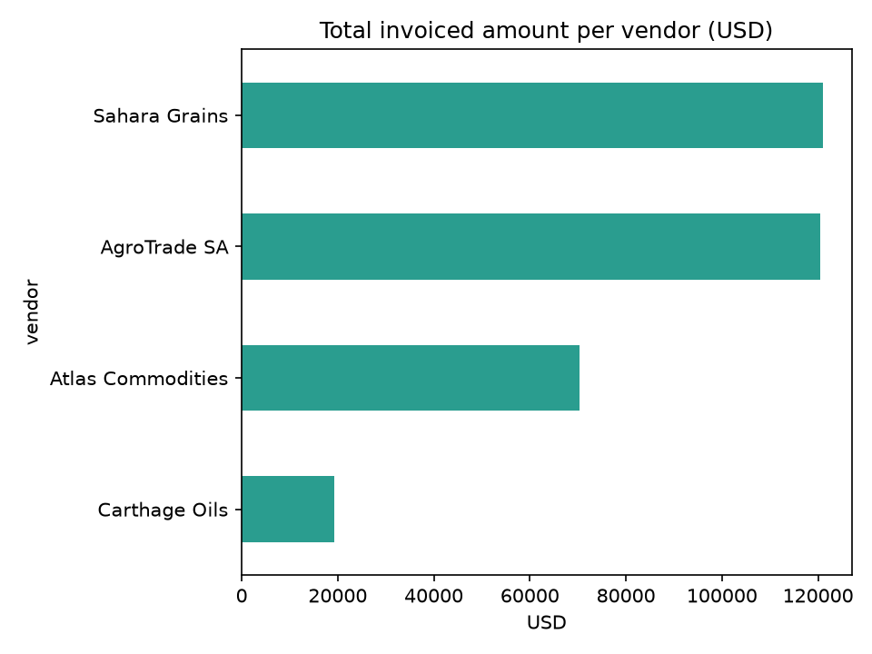

# Invoice Data Extraction Pipeline (local LLM)

A small end-to-end data pipeline that turns PDF invoices into clean, validated,
queryable data using a locally running LLM (Ollama).

## Pipeline

PDF invoices → text extraction (pdfplumber) → field extraction with a local LLM
(Ollama, llama3.2:3b) → validation & cleaning (pandas) → SQL storage (SQLite)
→ chart (matplotlib)

## Data quality checks
- Required fields must be present (invoice number, vendor, date, total)
- Types are enforced (dates, numbers)
- Rule: quantity × unit price must equal the total
- Invoices failing a check are flagged `valid = False`

## Results
[X] of 10 invoices were extracted and validated successfully.
[Write 1-2 sentences: what failed and why, e.g. "the model sometimes misread the date format".]

## How to run
1. Install Python 3.10+ and [Ollama](https://ollama.com), then `ollama pull llama3.2:3b`
2. `pip install -r requirements.txt`
3. `python generate_invoices.py` (creates 10 synthetic invoices)
4. `python pipeline.py`

## Notes
- The invoices are synthetic (generated by `generate_invoices.py`), not real data.
- Next steps: add OCR for scanned documents, orchestration with Dagster/Airflow,
  and a Power BI dashboard.

Author: Kenza Ayadi